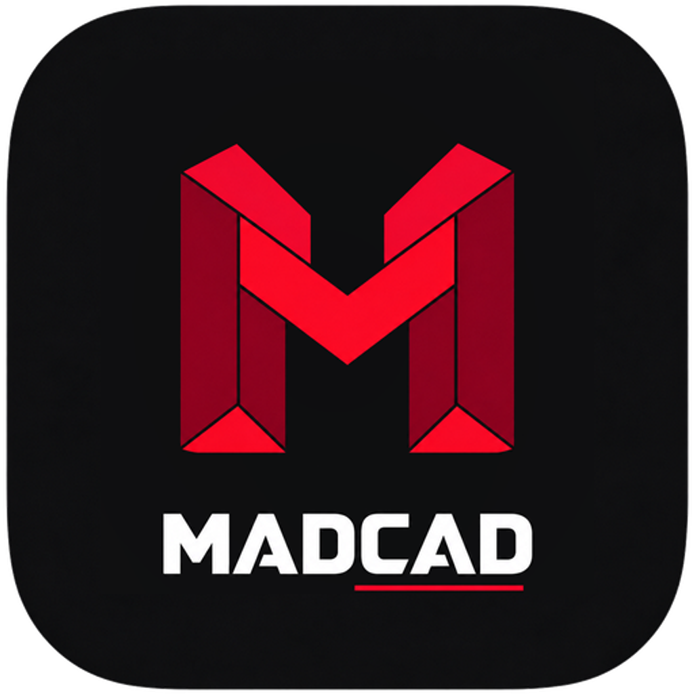

<p align="center">
  
</p>

<h1 align="center">MadCAD 8</h1>

<p align="center">
  <strong>Prosty program CAD 2D i 3D po polsku.</strong><br />
  Szkic z wymiarami i wiązaniami → Wyciągnij, Obrót, Otwór, Zaokrąglij, Faza, Szyk, Lustro.
  Zmień wymiar, a model przebuduje się sam.
</p>

## Pobierz

Najnowsze wydanie: [github.com/kamil5646/MadCAD/releases/latest](https://github.com/kamil5646/MadCAD/releases/latest)

- **macOS (Apple Silicon):** `MadCAD-<wersja>-mac-arm64.dmg` — przeciągnij MadCAD do Aplikacji.
  Aplikacja nie jest podpisana przez Apple: przy pierwszym uruchomieniu kliknij ją prawym
  przyciskiem → Otwórz.
- **Windows (x64):** `MadCAD-<wersja>-windows-x64.exe` (jeden plik, bez instalacji) albo
  `.zip` z narzędziem wiersza poleceń. Windows SmartScreen może ostrzec o nieznanym wydawcy:
  Więcej informacji → Uruchom mimo to.

## MadCAD 8 a wersje 7.x

MadCAD 8 to nowy program napisany w Rust, oparty na otwartym projekcie
[SolidCraft](https://github.com/tangency-labs/solidcraft) (MIT / Apache-2.0).
Projekty zapisuje w formacie `.sc`. Pliki `.madcad` z wersji 7.x nie są otwierane —
wersja 7.x pozostaje dostępna w [starszych wydaniach](https://github.com/kamil5646/MadCAD/releases)
i na gałęzi `main`.

## Budowanie

```bash
bash packaging/madcad/build-mac.sh 8.0.8      # macOS: dist/MadCAD-8.0.8-mac-arm64.{dmg,zip}
```

Windows buduje workflow `.github/workflows/madcad-windows.yml` przy każdym pushu na gałąź `madcad8`.

## Licencja i autorzy

MadCAD 8 jest rozpowszechniany na licencji MIT lub Apache-2.0, jak SolidCraft.
Licencje, NOTICE i atrybucja: [LICENSE-MIT](LICENSE-MIT), [LICENSE-APACHE](LICENSE-APACHE),
[NOTICE](NOTICE), [ATTRIBUTION.md](ATTRIBUTION.md). Opis zmian względem SolidCraft:
[packaging/madcad/CONTINUATION-2026-11-01.md](packaging/madcad/CONTINUATION-2026-11-01.md),
oryginalne README: [docs/README-SolidCraft.md](docs/README-SolidCraft.md).
